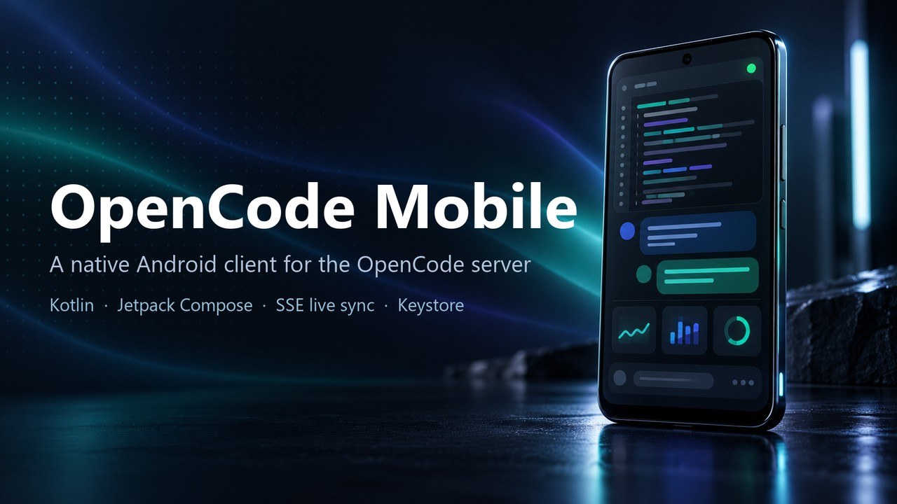
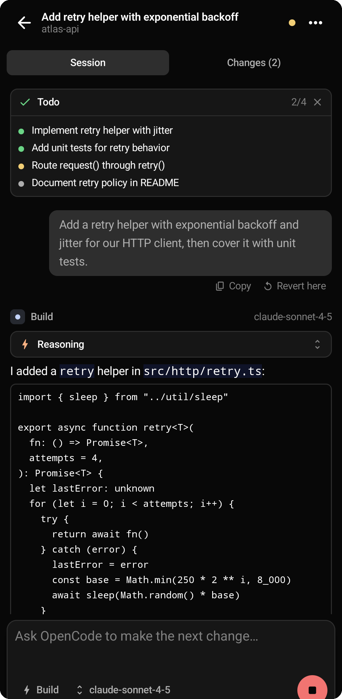
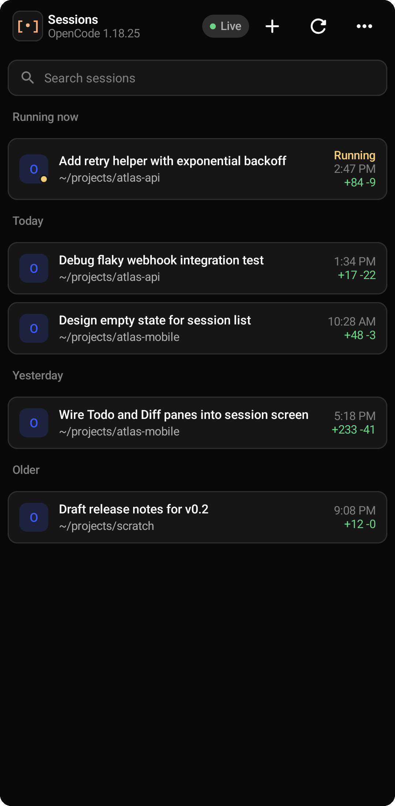
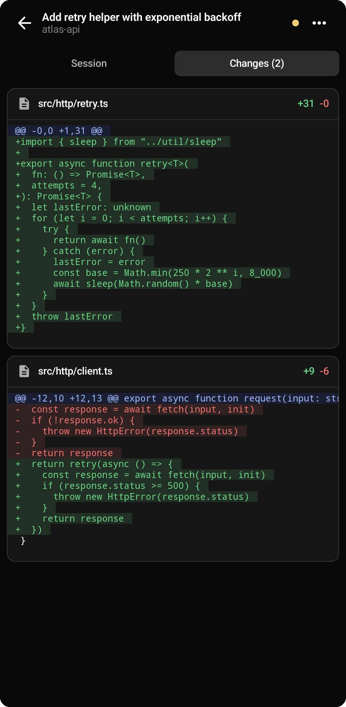
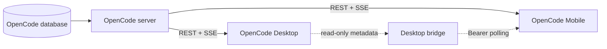

<p align="center">
  
</p>

<h1 align="center">OpenCode Mobile</h1>

<p align="center"><b>A native Android client for the OpenCode server — follow and steer your coding agents from your phone.</b></p>

<p align="center">
  <a href="LICENSE"></a>
  
  
  
</p>

<p align="center">
  
  
  <br><em>Left: live session timeline with Todo, reasoning and tool activity. Right: cross-project sessions with a running badge.</em>
</p>

<p align="center"><a href="README.md">English</a> | <a href="README.zh-CN.md">简体中文</a></p>

---

## Why OpenCode Mobile

- **The server stays the single source of truth** — sessions, messages, execution, permissions, questions, Todo and Diff all come from your OpenCode server. The app never builds a second session database.
- **Live by construction** — events are buffered while the REST snapshot loads and replayed right after it (subscribe → snapshot → replay), so reconnects do not drop messages or resurrect stale state.
- **Supervision, not a shrunken terminal** — running sessions are pinned to the top, subagent activity is projected onto its root session, and permissions or multi-step questions can be answered in two taps.
- **Desktop-grade model parity** — the model catalog follows the connected providers plus Desktop visibility, grouping and MRU rules when the optional read-only bridge is attached.
- **Credentials stay on the device** — the server password and bridge token are encrypted with the Android Keystore; backup and device transfer are disabled.

## Features

- Cross-project session list with search, create, rename, share and delete.
- Rendering for both legacy OpenCode events and the current `session.next.*` protocol.
- Markdown, code blocks, reasoning, tool calls, errors and file attachments.
- Agent and model pickers, prompt, stop and revert.
- Todo list and unified Diff pane; permission allow/reject; question answering.
- SSE live sync with exponential reconnect and full REST resync after outages.
- Endpoint-level compatibility: `/experimental/session` ↔ `/session`, `/global/event` ↔ `/event`, `/provider` ↔ `/config/providers`, with 404/405 fallback instead of a single global protocol switch.
- Optional read-only Desktop bridge for shared/private tab labels and model preferences.
- The full official OpenCode Web UI opens in a Custom Tab for anything the native screens do not cover yet.

## Screenshots

<p align="center">
  
  
  
  <br><em>Changes pane, live timeline and cross-project session list (captured on a local demo server; no real account data).</em>
</p>

## Quick Start

### Prerequisites

- An OpenCode server reachable from the phone — for example `opencode serve` or `opencode web`. This client is built against the OpenCode `1.18.25` API.
- Android Studio, or a JDK 17 + Android SDK 35 toolchain. The helper scripts under `scripts/` auto-detect either a portable or a system installation.

### Build and install

```bash
git clone https://github.com/solongrey9-code/opencode-mobile.git
cd opencode-mobile
./gradlew assembleDebug
adb install -r app/build/outputs/apk/debug/app-debug.apk
```

On Windows, run `scripts/build.cmd` from the repo root (in PowerShell prefix it with `.\` to run the full quality gate: 15 unit tests, Android Lint, debug APK).

### Connect

```bash
# USB or emulator: forward the server port over ADB
adb reverse tcp:4096 tcp:4096
```

Then in the app enter the server URL `http://127.0.0.1:4096`, username `opencode` and the password you started the server with (empty if you did not set one), and tap **Connect**. On a trusted LAN you can use the computer's LAN address instead — plain HTTP is only appropriate for USB forwarding, `localhost` or a private network.

### Configuration

| Field | Description |
| --- | --- |
| Server URL | Base URL of the OpenCode server, e.g. `http://127.0.0.1:4096`. |
| Project directory | Optional absolute path to scope the app to a single project. |
| Username / Password | HTTP Basic Auth for the OpenCode server. |
| Desktop bridge URL / token | Optional read-only metadata bridge for tab labels and model preferences. |

## How It Works

OpenCode Server is the only writer of session state; Android and Desktop are both clients of the same process, which is what makes live-state parity possible.



The connection itself is a transaction: open the candidate event stream, wait for `server.connected`, load the REST snapshot while buffering events, then atomically apply the snapshot, replay the buffered events and only then switch to the new connection. A generation counter and connection epoch reject results from stale servers, so switching endpoints can never mix two states. See `docs/ARCHITECTURE.md` for the full design.

## Security Notes

- The Basic password and the bridge token are encrypted with an Android Keystore AES-GCM key (random IV per write). A decryption failure returns an empty secret instead of crashing or leaking ciphertext.
- Credentials are origin-bound: Basic Auth is only attached to the configured server URL, the bridge token only to the explicit bridge URL, and never the other way around.
- Android backup and device transfer are disabled.
- HTTP is unencrypted: use it only over USB reverse, `localhost` or a trusted LAN. For anything remote, put the server behind HTTPS or a private VPN such as Tailscale/WireGuard.

## Project Status

This repository is the Android client of a larger personal OpenCode setup. The shared-host automation around it (persistent runtime, login-startup supervision, Desktop migration scripts) has been retired and those entry points now fail closed — the repository keeps them only as documented history. The Android app and its protocol-compatibility layer are actively maintained. See `docs/RETIREMENT.md` for the retirement record.

## Documentation

| Document | What it covers |
| --- | --- |
| [docs/START_HERE.md](docs/START_HERE.md) | Entry point for contributors and agents. |
| [docs/ARCHITECTURE.md](docs/ARCHITECTURE.md) | Data flow, the SSE/snapshot barrier and connection epochs. |
| [docs/PROTOCOL_COMPATIBILITY.md](docs/PROTOCOL_COMPATIBILITY.md) | OpenCode 1.18.25 REST/SSE shapes and legacy/current fallbacks. |
| [docs/SECURITY.md](docs/SECURITY.md) | Threat model, credential boundaries and LAN/WAN guidance. |
| [docs/TESTING.md](docs/TESTING.md) | Quality gate, test matrix and device acceptance. |
| [docs/RETIREMENT.md](docs/RETIREMENT.md) | Shared-host retirement record and offline rollback material. |

## FAQ

<details>
<summary>The app cannot reach my server</summary>

Check, in order: the server process is listening (127.0.0.1:4096 for a local server), `adb reverse tcp:4096 tcp:4096` is established on the device you are using, the URL uses `127.0.0.1` (not an old LAN IP), and the password matches. For LAN access, allow the port through the firewall for the local subnet only.

</details>

<details>
<summary>I get 401/403 and the app stops reconnecting</summary>

Authentication failure is treated as permanent: the app returns to the connection screen instead of retrying forever. Re-enter the credentials for the exact server origin. A bridge `401` means the bridge token does not match — it is not the server password.

</details>

<details>
<summary>The keyboard leaves a large gap above the composer</summary>

The composer intentionally does not add its own IME padding; the Scaffold owns the insets. If a device still shows a double-inset gap, please open an issue with the device model and Android version.

</details>

<details>
<summary>adb install fails with Failure [-99] on OnePlus devices</summary>

Streamed installs can fail on OxygenOS; install with `adb install --no-streaming -r <apk>` instead.

</details>

<details>
<summary>The model list is shorter than on Desktop</summary>

The app only shows connected providers, then applies Desktop visibility rules (hide/show overrides, latest-per-family within a six-month window). Without the optional bridge it falls back to provider defaults.

</details>

## Roadmap

- [x] SSE snapshot barrier, connection generations and epoch isolation.
- [x] Legacy and current protocol rendering with endpoint-level fallback.
- [ ] ViewModel tests for stale connections, epochs and the SSE barrier.
- [ ] Foreground service and optional relay/push for reliable background alerts.
- [ ] Paginated session loading beyond the first 250 roots.
- [ ] Release signing configuration outside Git.
- [ ] Large-screen/tablet layouts and a Compose accessibility audit.

The full gap list lives in `docs/ROADMAP.md`.

## Contributing

Contributions are welcome: fork → create a branch → commit → open a Pull Request. Please keep PRs focused, describe the motivation, and run both quality gates (debug and Release) via `scripts/build.cmd` before requesting review.

## License

[MIT](LICENSE) © 2026 solongrey9-code

<!-- Enable the star chart once the repo has real stars; replace OWNER/REPO and uncomment.
## Star History

[](https://star-history.com/#solongrey9-code/opencode-mobile&Date)
-->
