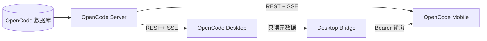

<p align="center">
  
</p>

<h1 align="center">OpenCode Mobile</h1>

<p align="center"><b>OpenCode 服务端的原生 Android 客户端 —— 在手机上跟随并干预你的编码 Agent。</b></p>

<p align="center">
  <a href="LICENSE"></a>
  
  
  
</p>

<p align="center">
  
  
  <br><em>左：带 Todo、推理与工具活动的实时会话时间线。右：跨项目会话列表与运行中标记。</em>
</p>

<p align="center"><a href="README.md">English</a> | <a href="README.zh-CN.md">简体中文</a></p>

---

## 为什么是 OpenCode Mobile

- **服务端是唯一事实来源** —— 会话、消息、执行状态、权限、问题、Todo 和 Diff 全部来自你的 OpenCode 服务端；App 不建立第二份会话数据库。
- **天生实时** —— 事件流先订阅、REST 快照加载期间先缓冲、快照应用后再重放（subscribe → snapshot → replay），断线重连不会丢消息，也不会让旧状态复活。
- **为监督而生，不是缩小的终端** —— 运行中会话置顶，子 Agent 活动投影到根会话，权限和多步问题两步内即可回答。
- **与 Desktop 同级的模型一致性** —— 接入可选只读桥接后，模型列表遵循 connected provider、Desktop 可见性、分组和 MRU 规则。
- **凭据只留在设备上** —— 服务端密码与桥接 token 使用 Android Keystore 加密；已禁用备份与设备迁移。

## 功能

- 跨项目会话列表：搜索、新建、重命名、分享、删除。
- 同时渲染 legacy OpenCode 事件与当前 `session.next.*` 协议。
- Markdown、代码块、Reasoning、工具调用、错误与文件附件。
- Agent / 模型选择、发送、停止与消息还原。
- Todo 列表与统一 Diff 面板；权限允许/拒绝；问题回答。
- SSE 实时同步，指数退避重连，断线后 REST 全量校准。
- 端点级兼容：`/experimental/session` ↔ `/session`、`/global/event` ↔ `/event`、`/provider` ↔ `/config/providers`，按 404/405 回退而非全局协议开关。
- 可选只读 Desktop 桥接，用于共享/私有标签标记和模型偏好。
- 尚未原生覆盖的功能通过系统 Custom Tab 打开官方完整 Web UI。

## 截图

<p align="center">
  
  
  
  <br><em>Changes 面板、实时时间线与跨项目会话列表（在本地演示服务上采集，不含真实账号数据）。</em>
</p>

## 快速开始

### 前置条件

- 手机可访问的 OpenCode 服务端，例如 `opencode serve` 或 `opencode web`。本客户端基于 OpenCode `1.18.25` API 构建。
- Android Studio，或 JDK 17 + Android SDK 35 工具链。`scripts/` 下的辅助脚本会自动探测便携或系统安装。

### 构建与安装

```bash
git clone https://github.com/solongrey9-code/opencode-mobile.git
cd opencode-mobile
./gradlew assembleDebug
adb install -r app/build/outputs/apk/debug/app-debug.apk
```

Windows 上在仓库根目录运行 `scripts\build.cmd`（PowerShell 中需加 `.\` 前缀），一条命令完成完整质量门（15 个单元测试、Android Lint、Debug APK）。

### 连接

```bash
# USB 或模拟器：通过 ADB 转发服务端端口
adb reverse tcp:4096 tcp:4096
```

然后在 App 中填写服务地址 `http://127.0.0.1:4096`、用户名 `opencode` 和启动服务端时设置的密码（未设置则留空），点击 **Connect**。可信局域网内也可以直接使用电脑的局域网地址；明文 HTTP 只适合 USB 转发、`localhost` 或可信内网。

### 配置项

| 字段 | 说明 |
| --- | --- |
| 服务地址 | OpenCode 服务端 Base URL，例如 `http://127.0.0.1:4096`。 |
| 项目目录 | 可选，绝对路径，用于把 App 限定在单个项目。 |
| 用户名 / 密码 | OpenCode 服务端的 HTTP Basic 凭据。 |
| Bridge 地址 / Token | 可选只读元数据桥接，用于标签标记与模型偏好。 |

## 工作原理

OpenCode Server 是会话状态的唯一写入方；Android 与 Desktop 都是同一进程的客户端，这也是实时状态一致的前提。



连接切换本身是一个事务：先打开候选事件流并等待 `server.connected`，在加载 REST 快照期间缓冲事件，随后原子地应用快照、重放缓冲事件，最后才切换到新连接。代次计数与连接 epoch 会拒绝过期服务端的结果，切换端点不可能混入两份状态。完整设计见 `docs/ARCHITECTURE.md`。

## 安全说明

- Basic 密码与桥接 token 使用 Android Keystore AES-GCM 密钥加密（每次写入随机 IV）。解密失败返回空密钥，不会崩溃，也不会返回密文。
- 凭据与 Origin 绑定：Basic 只发往配置的服务端地址，桥接 token 只发往显式配置的桥接地址，绝不混用。
- 已禁用 Android 备份与设备迁移。
- HTTP 无传输加密：仅限 USB 转发、`localhost` 或可信内网。远程访问应使用 HTTPS 或 Tailscale/WireGuard 等私有 VPN。

## 项目状态

本仓库是一套个人 OpenCode 环境中的 Android 客户端部分。围绕它的共享主机自动化（持久 runtime、登录自启动监督、Desktop 迁移脚本）已完成退役，旧入口一律拒绝启用——仓库中仅作为历史记录保留。Android 应用及其协议兼容层仍在维护。退役记录见 `docs/RETIREMENT.md`。

## 文档

| 文档 | 内容 |
| --- | --- |
| [docs/START_HERE.md](docs/START_HERE.md) | 贡献者与 Agent 的最短入口。 |
| [docs/ARCHITECTURE.md](docs/ARCHITECTURE.md) | 数据流、SSE/快照屏障与连接 epoch。 |
| [docs/PROTOCOL_COMPATIBILITY.md](docs/PROTOCOL_COMPATIBILITY.md) | OpenCode 1.18.25 REST/SSE 形状与 legacy/current 回退。 |
| [docs/SECURITY.md](docs/SECURITY.md) | 威胁模型、凭据边界与局域网/广域网建议。 |
| [docs/TESTING.md](docs/TESTING.md) | 质量门、测试矩阵与真机验收。 |
| [docs/RETIREMENT.md](docs/RETIREMENT.md) | 共享主机退役记录与离线回退材料。 |

## 常见问题

<details>
<summary>App 连不上服务端</summary>

依次检查：服务端进程在监听（本机服务为 127.0.0.1:4096）；当前设备上已建立 `adb reverse tcp:4096 tcp:4096`；地址使用 `127.0.0.1`（不是旧的局域网 IP）；密码正确。走局域网时，防火墙只放行本地子网。

</details>

<details>
<summary>出现 401/403 且不再重连</summary>

认证失败被视为永久错误：App 会回到连接页而不是无限重试。请针对确切的服务器 Origin 重新输入凭据。桥接返回 `401` 表示桥接 token 不匹配，与服务端密码无关。

</details>

<details>
<summary>键盘上方出现大片空白</summary>

Composer 有意不再叠加 IME padding，inset 由 Scaffold 统一处理。若某设备仍出现双重 inset 空白，请附上机型与 Android 版本提 issue。

</details>

<details>
<summary>OnePlus 设备 adb install 报 Failure [-99]</summary>

OxygenOS 对流式安装存在兼容问题，请改用 `adb install --no-streaming -r <apk>`。

</details>

<details>
<summary>模型列表比 Desktop 少</summary>

App 只显示已连接 Provider，并应用 Desktop 可见性规则（hide/show 覆盖、约六个月窗口内按 family 取最新）。未接入可选桥接时回退为 Provider 默认。

</details>

## 路线图

- [x] SSE 快照屏障、连接代次与 epoch 隔离。
- [x] legacy 与 current 协议渲染及端点级回退。
- [ ] 覆盖过期连接、epoch 与 SSE 屏障的 ViewModel 测试。
- [ ] 前台服务与可选 relay/推送，实现可靠后台提醒。
- [ ] 超过前 250 个根会话的分页加载。
- [ ] Git 之外的 Release 签名配置。
- [ ] 大屏/平板布局与 Compose 无障碍审计。

完整缺口清单见 `docs/ROADMAP.md`。

## 参与贡献

欢迎贡献：fork → 新建分支 → 提交 → 发起 Pull Request。请保持 PR 聚焦、说明动机，并在请求审查前用 `scripts\build.cmd` 跑完两道质量门（debug 与 Release）。

## 许可证

[MIT](LICENSE) © 2026 solongrey9-code

<!-- 仓库拿到真实 star 后替换 OWNER/REPO 并取消注释。
## Star History

[](https://star-history.com/#solongrey9-code/opencode-mobile&Date)
-->
